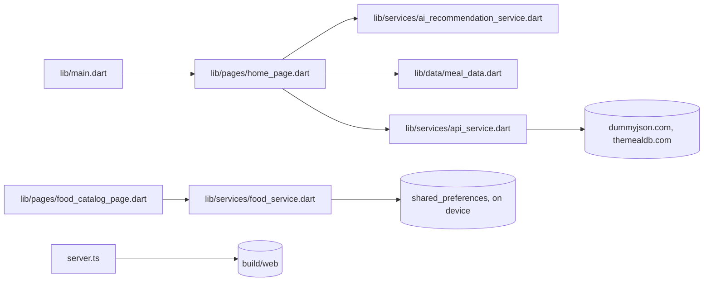

<div align="center">

<!-- TODO(screenshot): home dashboard with the daily plan and calorie/macro bars; hero image for the header (no icon in the repo yet) -->

# 🥗 WebDiet (Meal Planning)

**A modern meal planning and health application built with Flutter and Node.js.**<br/>
Daily meal plan, calorie and macro totals, and a shopping list, in English and Portuguese.

[](https://flutter.dev/)
[](https://nodejs.org/)
[](https://expressjs.com/)
[](https://opensource.org/licenses/MIT)

<sub>**English** · <a href="README.pt.md">Português</a></sub>

</div>

> Plan breakfast, lunch and dinner against a daily calorie target, track the day's macros, and turn the plan into a shopping list. Start with `flutter run`.

## 💡 Why WebDiet

WebDiet is a meal planning app for patients and nutritionists. It is built to replace older diet tools with a clean, light interface (mint green, no heavy borders). It is a planning aid, not a clinical tool.

- **One screen for the day**: meals, calories, and protein/carbs/fat progress.
- **Local first**: the food catalog is stored on the device, with no account required.
- **Bilingual**: English and Portuguese, selected from the device locale.

Orchestrated by **Jules-Architect** and **Chef-Domain**, the AI personas defined in [AGENTS.md](AGENTS.md).

## 📸 Tour

TODO(screenshot): home dashboard (daily plan, calorie and macro bars), meal detail, food catalog, BMI calculator, shopping list. Captures must come from the running app.

## 🚀 Getting Started

Requirements: Flutter SDK (stable channel), Node.js 20+, and pnpm 10 (`packageManager` in `package.json`).

```bash
flutter pub get          # Dart dependencies
flutter run              # run the app on a device or in the browser
```

Web build and local server:

```bash
pnpm install             # Node dependencies (pnpm-lock.yaml)
flutter build web --release   # build the web app into build/web (same step as build_web.sh)
pnpm start               # serve build/web with Express on PORT (default 8080)
```

`netlify.toml` runs `build_web.sh` and publishes `build/web`.

## 🧭 Usage

Start the static server after building the web app:

```bash
PORT=8089 pnpm start
```

```text
App listening on port 8089
```

Until `build/web` exists, requests to `/` return 404.

## ✨ Features

- **Daily meal plan**: breakfast, lunch, and dinner options with calories, macros, ingredients, and description (`lib/data/meal_data.dart`).
- **Calorie suggestion**: the Surprise me action on the home page picks the breakfast/lunch/dinner combination closest to the daily calorie target by checking every combination (`lib/services/ai_recommendation_service.dart`). It is rule-based, not an external AI service.
- **Nutrient dashboard**: calorie total, protein, carbs, and fat progress bars, plus a water intake counter.
- **Shopping list**: groups the ingredients of the day's meals and marks items as bought.
- **Food catalog**: add, edit, and delete foods with calories and macros; attach a photo (`lib/pages/food_catalog_page.dart`, `lib/pages/food_form_page.dart`).
- **BMI calculator**: body mass index with a category label (`lib/utils/bmi_calculator.dart`).
- **Random content**: a motivational quote and a random recipe from keyless public APIs.

## 🛠️ How it works



- The app has no backend database. Foods live in `shared_preferences` on the device.
- `server.ts` only serves the built Flutter web app, with a fallback to `index.html` for client routes.
- The calorie suggestion runs on the client over the static meal options, so it works offline.

| Layer | Technology |
|---|---|
| Mobile and web UI | Flutter (Dart), state with `StatefulWidget` and `setState` |
| Local storage | `shared_preferences` |
| Static server | Node.js 20+, Express 5, TypeScript (`tsx`) |
| CI/CD | GitHub Actions (`.github/workflows/`) and semantic-release (`release.config.ts`) |

## ⚙️ Configuration

| Variable | Purpose | Required / default | Example |
|---|---|---|---|
| `PORT` | HTTP port used by `pnpm start` (`server.ts`) | optional, `8080` | `PORT=8089 pnpm start` |

## 🧑‍💻 Develop

```sh
pnpm install              # Node dependencies from pnpm-lock.yaml
pnpm start                # serve build/web on $PORT (default 8080)
pnpm run build:server     # compile server.ts with tsc (writes dist/)
pnpm run release          # semantic-release: tags and GitHub releases (maintainers only)
flutter pub get           # Dart dependencies
flutter gen-l10n          # regenerate lib/l10n/generated from app_en.arb and app_pt.arb
flutter run               # run the app in debug mode
flutter test              # unit and widget tests in test/
flutter build web --release   # production web build into build/web
```

## 🤝 Contributing

Follow [CONTRIBUTING.md](CONTRIBUTING.md). Commit messages use Conventional Commits, because semantic-release derives versions from them.

### 🛡️ Antigravity Protocol

This project follows the **Antigravity** code standards from [AGENTS.md](AGENTS.md):

- **Clean backend architecture**: business rules separated from routes and UI widgets.
- **Modular Flutter widgets**: reusable components for a consistent visual identity.
- **Strict typing**: typed API contracts and Flutter models.
- **150-line limit**: the target for Node.js and Flutter logic files. Two widgets exceed it today (see Known limitations).

## 📚 Documentation

| Document | What's in it |
|---|---|
| 🇧🇷 <a href="README.pt.md">README (pt-BR)</a> | Portuguese version of this page |
| 🔐 <a href="docs/security/security_audit.md">Security audit</a> | secrets review, dependency updates, Dependabot setup |
| 🗺️ <a href="ROADMAP.md">Roadmap</a> | product vision and planned work |

## 🔒 Security

- No secrets are committed; `.gitignore` excludes `.env` files and key files. Details in [docs/security/security_audit.md](docs/security/security_audit.md).
- The app calls two public APIs without keys: `dummyjson.com` (quotes) and `themealdb.com` (recipes).
- The static server only serves `build/web`; it has no write endpoints.

## ⚠️ Known limitations

- No accounts or cloud sync. Foods and settings stay on the device.
- Meal options are static sample data in `lib/data/meal_data.dart`; all nine entries share one placeholder photo (`assets/images/lanche.jpg`).
- The calorie suggestion only chooses among the static meal options.
- The quote and recipe features depend on third-party APIs that may be unavailable.
- Two files exceed the 150-line guideline: `lib/widgets/food_catalog_card.dart` (196) and `lib/widgets/food_form_body.dart` (175).
- BMI categories are general guidance and do not replace a professional assessment.
- Flutter web needs the Flutter SDK to build; `pnpm start` alone serves nothing until `build/web` exists.

## 🙏 Inspirations

| Project | What we learned |
|---|---|
| [WebDiet](https://webdiet.com.br/site/HOME) | visual direction: clean mint colors and light borders for patients and nutritionists |

## 📄 License

MIT, as declared by the badge above. The repository does not yet include a `LICENSE` file.

---

*"Healthy living starts with a better plan."*
